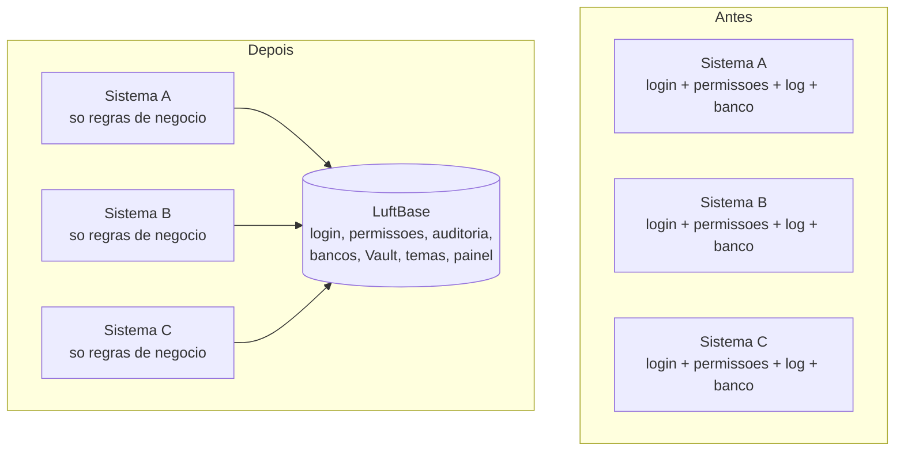

# Visao do produto

## Em uma frase

O **LuftBase** e a plataforma que todo sistema web em Python da Luft instala para **nao ter de reescrever o que e igual em todos**:
configuracao, segredos, bancos, login, permissoes, auditoria, notificacoes, temas, e-mail, servidor e um Painel de Controle.
O sistema escreve **so as regras de negocio dele**.

## Que problema resolve

Antes, cada sistema tinha a sua copia de login, de controle de acesso, de log, de conexao com o banco e de tela de administracao.
Uma correcao de seguranca exigia mexer em todos; um sistema novo comecava semanas atras. O LuftBase concentra isso **em um pacote
versionado**: corrigiu aqui, todos recebem trocando uma versao.

## Para quem e

| Voce e... | O LuftBase serve para... | Comece por |
|---|---|---|
| **Quem desenvolve um sistema novo ou mantem um existente** | criar o projeto ja no padrao, com login, permissoes e banco prontos | [Guia rapido](22-GUIA-RAPIDO-DO-DESENVOLVEDOR.md) |
| **Quem administra o ambiente** (TI, seguranca) | conceder acessos, ver auditoria, reiniciar servicos, cadastrar sistemas, tudo no Painel de Controle | [Painel de Controle](14-PAINEL-DE-CONTROLE.md) |
| **Quem opera o servidor e o deploy** | publicar versoes, acompanhar saude, resolver incidentes | [Operacao e deploy](20-OPERACAO-E-DEPLOY.md) |

## O que o LuftBase faz (responsabilidades)

| Area | O que entrega | Documento |
|---|---|---|
| Configuracao e ambientes | um `.env` minimo; o resto vem do Vault, por ambiente | [04](04-CONFIGURACAO-E-VAULT.md), [18](18-VARIAVEIS-DE-AMBIENTE.md) |
| Vault e conexoes | credenciais, bancos e ciclo de vida das sessoes de banco | [04](04-CONFIGURACAO-E-VAULT.md), [05](05-BANCO-E-SCHEMAS.md) |
| Identidade e SSO | login corporativo (LDAP) e sessao compartilhada entre sistemas | [10](10-IDENTIDADE-E-SESSAO.md) |
| Autorizacao | permissoes em arvore, cache, decisao que nega na duvida | [11](11-AUTORIZACAO.md) |
| Auditoria e observabilidade | quem fez o que, antes e depois; alertas ao desenvolvedor | [12](12-AUDITORIA-E-OBSERVABILIDADE.md), [15](15-AUDITORIA-ANALITICA-E-CONTROLE-DE-SESSOES.md) |
| Comunicacao | notificacoes, comunicados e notas de atualizacao | [13](13-NOTIFICACOES-E-PUBLICACOES.md), [21](21-CONTEUDO-RICO-E-NOTAS-DE-ATUALIZACAO.md) |
| Interface | layout, temas claro/escuro, componentes, acessibilidade, perfil | [07](07-DESIGN-SYSTEM-E-TEMAS.md), [16](16-PERFIL-DO-USUARIO.md) |
| Catalogo de sistemas | cadastro, categorias, sistemas externos (C#, executaveis) | [24](24-SISTEMAS-E-CATALOGO.md) |
| Ferramentas do desenvolvedor | CLI, geracao de projetos, banco local, comparacao de estrutura | [22](22-GUIA-RAPIDO-DO-DESENVOLVEDOR.md), [23](23-REFERENCIA-DA-CLI.md), [25](25-BANCO-LOCAL-E-PROMOCAO-DE-ESTRUTURA.md) |
| Servidor e operacao | Waitress, prefixo de URL, fuso de Brasilia, saude, deploy | [17](17-SERVIDOR-REDE-E-FUSO.md), [20](20-OPERACAO-E-DEPLOY.md) |

## O que **nao** e do LuftBase (fica na aplicacao)

- regras de negocio, modelos e repositorios do proprio dominio;
- rotas e telas especificas do sistema;
- integracoes que nao sejam corporativas (por exemplo, a leitura do ERP);
- o conteudo e o gatilho dos e-mails e das notificacoes que o sistema envia.

E o que o LuftBase **nao atende**: sistemas feitos em outras tecnologias (C#, executaveis, ferramentas de terceiros) **nao
usam** o LuftBase, mas **podem constar do catalogo** com card e link ([doc 24](24-SISTEMAS-E-CATALOGO.md)).

## Principios

1. **Uma inicializacao.** A aplicacao chama `PlataformaLuft().inicializar(app)` uma vez; configuracao igual em todos os sistemas nao vira
   argumento repetido.
2. **Convencao forte, API pequena.** Todo sistema tem a mesma estrutura e os mesmos nomes ([ADR-017](decisoes/ADR-017-PADRAO-DE-PROJETO-DAS-APLICACOES.md)).
   Pontos de extensao existem para necessidades reais, nao para desmontar o padrao.
3. **Seguro por padrao.** Segredos so no Vault; o runtime nunca usa usuario administrativo; permissao que nao pode ser comprovada e **negada**;
   nada de token, senha ou cookie em log.
4. **Nada de surpresa no banco.** Migracoes so por comando explicito; sempre aditivas; o SQL Server do diretorio e **somente leitura**.
5. **Nada de estado global.** Todo o estado vive em `app.extensions["luftbase"]`, por aplicacao.
6. **Falhar cedo e claro.** Configuracao invalida impede a inicializacao e diz qual campo esta errado; nao ha fallback silencioso para outro banco ou credencial.

## Quem usa hoje

Luft-Workspace (portal e Painel de Controle de todo o ecossistema), Luft-ConnectAir, Luft-Integrador e Luft-Control. A lista e o estado de cada
um estao no [README](../README.md); a ordem de adocao e o que falta estao no [Roadmap](../ROADMAP.md).
