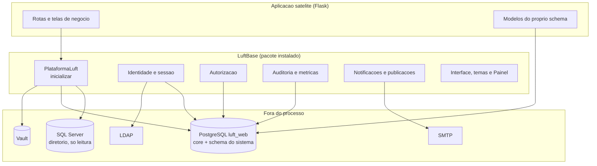
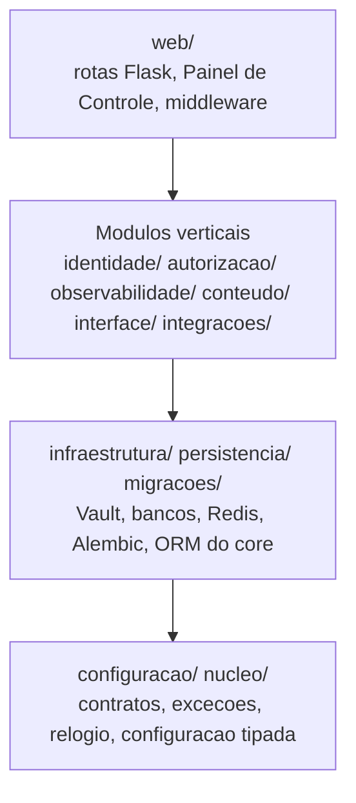
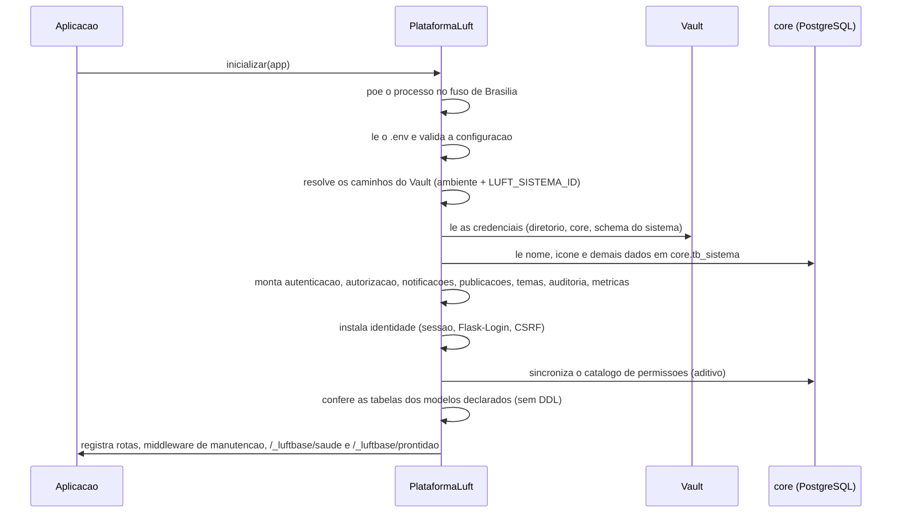
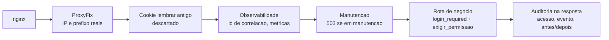

# Arquitetura

Este documento mostra **como o LuftBase e montado por dentro**: as camadas do codigo, o que acontece quando uma aplicacao sobe, o
caminho de uma requisicao e onde cada dado mora. Para usar o LuftBase sem entrar nos detalhes, comece pelo
[guia rapido](22-GUIA-RAPIDO-DO-DESENVOLVEDOR.md).

## Visao geral

## Camadas do codigo

O codigo de `src/luftbase/` segue uma regra de dependencia: **as camadas de cima conhecem as de baixo, nunca o contrario**.

| Pacote | Responsabilidade |
|---|---|
| `nucleo/` | contratos fundamentais sem Flask nem SQLAlchemy: excecoes publicas e o **relogio unico** (horario de Brasilia) |
| `configuracao/` | configuracao tipada e imutavel; ambientes; caminhos do Vault; validacao de identificadores |
| `infraestrutura/` | adaptadores externos: Vault, conexoes, Redis, provisionamento, cadastro de sistemas, espelho e comparacao de bancos |
| `persistencia/` | modelos ORM do schema `core` (`BaseLuft`) e do diretorio (somente leitura) |
| `migracoes/` | migracoes Alembic **empacotadas**, com uma revisao por mudanca |
| `identidade/` | autenticacao corporativa (LDAP), sessao compartilhada e revogavel, usuario no core |
| `autorizacao/` | catalogo de permissoes, resolucao em arvore, cache em duas camadas, decorators |
| `observabilidade/` | auditoria encadeada, metricas, logs estruturados, alertas, retencao, painel "ao vivo" |
| `conteudo/` | notificacoes, comunicados e notas de atualizacao (Markdown seguro) |
| `interface/` | design system, temas, preferencias, busca global, parametros da aplicacao |
| `integracoes/` | diagnostico das dependencias e versoes (aba Integracoes) |
| `estrutura/` | declaracao e verificacao das tabelas particulares da aplicacao |
| `web/` | blueprints do Painel de Controle, autenticacao, auditoria, manutencao, respostas padronizadas |
| `cli/` | comandos `luftbase` ([referencia](23-REFERENCIA-DA-CLI.md)) |
| `geracao/` | gerador do esqueleto de uma aplicacao (`projeto novo`) |
| `servidor.py`, `plataforma.py` | servidor padrao (Waitress) e o ponto unico de inicializacao |

## O que acontece em `inicializar(app)`

Importar `luftbase` **nao faz rede**. Vault e bancos so sao acessados dentro de `PlataformaLuft(...).inicializar(app)`, que faz, nesta ordem:

Se qualquer passo falha (configuracao, token, payload ou conexao invalidos), a aplicacao **nao sobe** e o erro diz o que corrigir. Nao existe
fallback silencioso para outra credencial, outro schema ou outro banco.

O estado fica em `app.extensions["luftbase"]` (um objeto por aplicacao, acessivel por `obter_luftbase()`). Nao ha singleton global, o que
permite varias aplicacoes e testes no mesmo processo.

## O caminho de uma requisicao

Na ordem em que os ganchos do Flask sao registrados: primeiro descarta-se o cookie "lembrar" que versoes antigas gravavam (a sessao do
LuftBase e do servidor), depois entram a correlacao e as metricas, depois a checagem de manutencao. A sessao em si (cookie assinado,
conferida contra o armazenamento) e carregada quando o codigo acessa o usuario atual. **Login e permissao sao decoradores da propria
rota** (`@login_required`, `@exigir_permissao`), por isso uma rota sem o decorador nao e protegida.

- **Sem permissao comprovada, nega**: anonimo recebe 401, negacao comprovada recebe 403 e qualquer falha que impeca comprovar recebe 503
  ([doc 11](11-AUTORIZACAO.md)).
- **Toda mutacao** envia o token CSRF; a sessao e assinada e revogavel ([doc 10](10-IDENTIDADE-E-SESSAO.md)).
- O erro 500 e registrado so com **tipos e linhas da pilha**, nunca com mensagem ou valores ([doc 12](12-AUDITORIA-E-OBSERVABILIDADE.md)).

## Onde cada dado mora

| Dado | Onde | Quem escreve |
|---|---|---|
| Usuarios e grupos corporativos | SQL Server (diretorio) | ninguem pelo LuftBase: **somente leitura** |
| Usuarios (copia), sessoes, permissoes, sistemas, auditoria, notificacoes | PostgreSQL, schema `core` | o LuftBase |
| Tabelas de negocio de cada sistema | PostgreSQL, schema do sistema (`connectair`, `faturas`...) | a aplicacao, com a role dela |
| Segredos (senhas, tokens, e-mail) | Vault, `luft/<ambiente>/...` | o provisionamento (CLI/Painel) |
| Cache de autorizacao e sinalizacao de conteudo | Redis (**opcional**) ou memoria | o LuftBase |
| Logs fisicos | arquivos `Logs/` (rotacao diaria) | o LuftBase |

> **Por padrao a sessao fica no PostgreSQL** (`core`), que e o caso de todos os ambientes atuais. O Redis e opcional: so e usado se o
> segredo `redis/sessoes` existir no Vault; sem ele, o cache de autorizacao e a sinalizacao de conteudo usam memoria
> ([doc 10](10-IDENTIDADE-E-SESSAO.md)). O PostgreSQL continua sendo a fonte definitiva dos dados.

## Limites (o que o LuftBase nunca faz)

- SQL Server e PostgreSQL usam **sessoes distintas**; uma sessao SQLAlchemy nunca atravessa dois bancos.
- O SQL Server corporativo e **somente leitura**.
- O schema `core` e propriedade da plataforma; o schema do sistema vem do segredo dele no Vault.
- **Migracoes nunca rodam sozinhas** na inicializacao; sao um comando explicito e **aditivo**.
- Nenhum listener e registrado na classe global `sqlalchemy.orm.Session`.
- Nenhuma configuracao e lida de variavel de ambiente fora do pacote `luftbase.configuracao`.
- Nenhum token, senha, cookie ou cabecalho de autorizacao vai para log.

As regras completas para quem contribui estao no [AGENTS.md](../AGENTS.md) e nos [padroes de codigo](06-PADROES-DE-CODIGO.md).

## Tecnologias

Python 3.11+, **Flask** 3 com **Flask-Login**, **SQLAlchemy** 2 e **psycopg** 3 (PostgreSQL), **pyodbc** (SQL Server do diretorio), **Alembic**
(migracoes), **hvac** (Vault), **ldap3** (login corporativo), **cryptography**, **Redis** (opcional) e **Waitress** (servidor de
producao). Dependencias e limites de versao: `pyproject.toml`.

## Decisoes que moldaram isto

[Indice de decisoes](README.md#decisoes-arquiteturais-adr). As mais importantes para entender a arquitetura:
[ADR-002](decisoes/ADR-002-API-UNICA.md) (API unica),
[ADR-003](decisoes/ADR-003-SCHEMAS.md) (schemas),
[ADR-005](decisoes/ADR-005-CREDENCIAIS-E-CONEXOES.md) (credenciais e conexoes),
[ADR-009](decisoes/ADR-009-SISTEMA-ID-COMO-BOOTSTRAP-UNICO.md) (`LUFT_SISTEMA_ID` como unico bootstrap),
[ADR-011](decisoes/ADR-011-AUTORIZACAO-HIERARQUICA-E-MODULOS.md) (autorizacao em arvore) e
[ADR-017](decisoes/ADR-017-PADRAO-DE-PROJETO-DAS-APLICACOES.md) (padrao de projeto).
