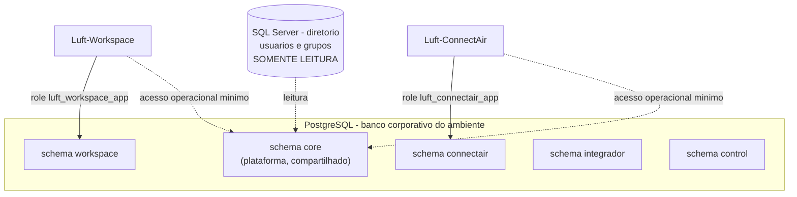

# Banco e schemas

Como os dados da plataforma e dos sistemas se organizam no PostgreSQL, quem pode ler e escrever o que, e como o codigo acessa cada parte.

## Resumo em um desenho



## Um banco por ambiente

| Ambiente | Banco core (padrao) | Observacao |
|---|---|---|
| Producao | `luft_web` | roles `luft_<schema>_app` |
| Homologacao | `luft_web_hml` | roles `luft_<schema>_hml_app` |
| Desenvolvimento | o banco **local** (por padrao `luft_web_dev`) | roles `luft_<schema>_dev_app`; veja [doc 25](25-BANCO-LOCAL-E-PROMOCAO-DE-ESTRUTURA.md) |

O nome real do banco de cada ambiente vem do **Vault** (segredo da conexao compartilhada), nao do codigo. Roles pertencem ao **cluster**
PostgreSQL, nao a um banco; por isso fora da producao a role leva o sufixo do ambiente, evitando que cadastrar um sistema em homologacao
troque a senha da role de producao.

## Schemas

```text
core       -> tabelas compartilhadas do LuftBase
workspace  -> tabelas particulares do Luft-Workspace
connectair -> tabelas particulares do Luft-ConnectAir
integrador -> tabelas particulares do Luft-Integrador
control    -> tabelas particulares do Luft-Control
<seu_sistema> -> um schema por sistema integrado novo
```

`public` nao recebe tabelas de aplicacao e nao concede `CREATE` a usuarios de runtime.

### As tabelas do `core`

| Assunto | Tabelas |
|---|---|
| Catalogo de sistemas | `tb_sistema` ([doc 24](24-SISTEMAS-E-CATALOGO.md)) |
| Usuarios e sessoes | `tb_usuario`, `tb_sessao`, `tb_sessao_evento` ([doc 10](10-IDENTIDADE-E-SESSAO.md)) |
| Autorizacao | `tb_modulo`, `tb_permissao`, `tb_permissaogrupo`, `tb_permissaousuario`, `tb_revisaocache` ([doc 11](11-AUTORIZACAO.md)) |
| Auditoria | `tb_logs` (acesso HTTP), `tb_logevento` (evento de negocio), `tb_logdetalhe` (antes/depois) ([doc 12](12-AUDITORIA-E-OBSERVABILIDADE.md)) |
| Alertas | `tb_alerta`, `tb_alerta_controle` |
| Notificacoes | `tb_notificacao`, `tb_notificacao_leitura`, `tb_notificacao_oculta` ([doc 13](13-NOTIFICACOES-E-PUBLICACOES.md)) |
| Comunicados e notas | `tb_publicacao`, `tb_publicacaogrupo`, `tb_publicacaoleitura`, `tb_publicacaonotificacao`, `tb_notaatualizacaoitem` |

## Propriedade e acesso

- as estruturas pertencem a uma role **administrativa** (dona e migradora), usada por quem opera o banco: nunca pela aplicacao;
- a aplicacao em execucao **nao** altera estrutura (DDL e feito por comando explicito, com um usuario administrativo);
- cada aplicacao possui login proprio (a role do sistema);
- todas as aplicacoes recebem privilegios operacionais minimos no `core`;
- somente aplicacoes administrativas recebem privilegios de administracao;
- a aplicacao acessa somente o seu schema particular.

Em outras palavras: o que **voce** executa para criar tabelas e o que a **aplicacao** executa em producao usam usuarios diferentes.

## Models

Models do `core` pertencem ao LuftBase e nao sao parametros publicos. Models de negocio pertencem aos projetos e devem declarar o schema
logico `luft_aplicacao`; o LuftBase troca esse nome pelo schema real (campo `esquema` do segredo no Vault) com `schema_translate_map`,
depois de validar o nome.

## Fronteiras disponiveis

| Fronteira | Banco | Escrita pelo LuftBase | Schema |
| --- | --- | --- | --- |
| `bancos.diretorio` | SQL Server `intec` | nunca | origem corporativa |
| `bancos.core` | PostgreSQL do ambiente | sim | `core` |
| `bancos.aplicacao` | PostgreSQL do ambiente | sim | recebido do Vault |

Core e aplicacao sao objetos e sessoes separados, mas compartilham um unico pool PostgreSQL. Isso evita dobrar conexoes contra o mesmo
servidor. SQL textual **nao** e reescrito pelo mecanismo de schema e deve ser evitado para acessar tabelas da aplicacao; quando for
inevitavel, use o helper `TabelaPostgres('tb_nome')` do projeto, que devolve o nome ja qualificado.

## Transacoes

```python
bancos = obter_luftbase().bancos

with bancos.core.leitura() as sessao:
    resultado = sessao.execute(...)

with bancos.aplicacao.unidade_trabalho() as sessao:
    sessao.add(entidade)
```

A unidade de trabalho confirma somente ao sair sem erro. Excecoes provocam rollback. Sessoes residuais sao removidas no teardown do contexto
Flask. Engines usam pool limitado, `pool_pre_ping`, reciclagem e timeout; descarte de pools e uma operacao explicita de ciclo de vida, nunca
executada a cada requisicao.

## Como as tabelas do sistema sao criadas

O LuftBase **nao cria** tabelas de negocio sozinho na inicializacao: ele so **confere** as tabelas dos modelos declarados e avisa no log as que
faltarem (`Tabela ausente: ...`). Cada tabela tem uma politica ([doc 03](03-API-PUBLICA-DESEJADA.md)):

| Politica | Significado |
|---|---|
| `EXTERNA_SOMENTE_LEITURA` | tabela de outro sistema; so leitura |
| `VALIDAR` | o LuftBase confere que existe, nunca cria |
| `GERENCIAR` | pode ser criada pelo comando `estrutura criar`, com credencial autorizada para DDL |

No fluxo normal de um sistema novo, as tabelas sao criadas no ambiente de desenvolvimento e **levadas** para homologacao e producao como
SQL revisado, gerado por `banco comparar` ([doc 25](25-BANCO-LOCAL-E-PROMOCAO-DE-ESTRUTURA.md)).

## Evolucao do `core`

O schema `core` e versionado por **Alembic**, com as migracoes **dentro do pacote** ([doc 09](09-PERSISTENCIA-E-MIGRACOES.md)). Cada banco
registra em `core.alembic_version` em que revisao esta. As regras:

- migracao **so por comando explicito** (`banco atualizar`, `banco atualizar-core` em desenvolvimento), nunca na inicializacao;
- migracoes **aditivas**: criar tabela ou coluna, nunca remover nem renomear (o codigo da versao anterior continua funcionando sobre o schema novo, o
  que torna o rollback seguro);
- para remover ou endurecer algo, sao necessarias duas versoes: a primeira para de usar, a segunda remove.
