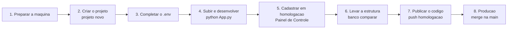

# Guia rapido do desenvolvedor

Este guia leva uma pessoa que **acabou de receber a tarefa de criar um sistema novo** (exemplo: "Luft-Faturas") do computador
vazio ate o sistema rodando em producao. Cada passo diz **o que fazer, o que acontece por baixo e como saber que deu certo**.

Se uma palavra nao for conhecida, procure no [glossario](27-GLOSSARIO.md). Se algo der errado, va para
[solucao de problemas](26-SOLUCAO-DE-PROBLEMAS.md).

## O caminho completo em uma olhada



A regra que sustenta tudo: **cada ambiente tem o seu banco, o seu Vault de segredos e a sua role**. Voce desenvolve no
ambiente de *desenvolvimento* (so seu), valida em *homologacao* e so entao chega em *producao*. Nada de producao e tocado
pelos comandos deste guia.

| Ambiente | Onde roda | Banco core | Segredos no Vault | Quem mexe |
|---|---|---|---|---|
| **Desenvolvimento** | a sua maquina | banco local (por padrao `luft_web_dev`) | `luft/desenvolvimento/...` | voce, livremente |
| **Homologacao** | servidor Linux | `luft_web_hml` | `luft/homologacao/...` | quem desenvolve, para validar |
| **Producao** | servidor Windows | `luft_web` | `luft/producao/...` | so o que passou por homologacao |

O Vault e **um so** para os tres ambientes; o que muda e a pasta (`luft/<ambiente>/...`).

---

## 1. Preparar a maquina (uma vez)

Voce precisa de:

- **Python 3.11 ou mais novo**;
- **acesso ao Vault** (um token de operador, pedido a quem administra o Vault);
- **um PostgreSQL local** para o ambiente de desenvolvimento (pode ser Docker ou WSL) e um usuario administrativo dele;
- o **LuftBase instalado** no ambiente Python que voce usa para os comandos.

```powershell
# Dentro da pasta do LuftBase (ou use o wheel/tag que a equipe indicar)
python -m venv .venv
.\.venv\Scripts\Activate.ps1
pip install -e ".[dev]"
python -m luftbase --version
```

> **Windows:** se `luftbase` nao for reconhecido no terminal, e porque a pasta `Scripts` do Python nao esta no `PATH`. Use
> `python -m luftbase ...`, que funciona sempre. Em todo este guia, `luftbase <comando>` e `python -m luftbase <comando>` sao
> a mesma coisa.

**Como saber que deu certo:** `python -m luftbase --version` imprime a versao do LuftBase.

## 2. Criar o projeto

Um unico comando cria a pasta do projeto **e** registra o sistema na plataforma:

```powershell
python -m luftbase projeto novo Luft-Faturas --destino C:\Projetos\LUFT\Python\Luft-Faturas
```

O comando mostra o plano (nome, schema, porta) e pergunta se pode criar. Depois:

1. cria a **pasta do projeto** no [padrao Luft](decisoes/ADR-017-PADRAO-DE-PROJETO-DAS-APLICACOES.md);
2. pede o **token do Vault** (nao aparece na tela);
3. descobre, no Vault, **qual e o banco do ambiente** e mostra o endereco;
4. pede o **usuario e a senha administrativos desse banco**. Em desenvolvimento e o seu PostgreSQL local; use o usuario
   administrador dele. Digite so a senha **do servidor mostrado na tela**;
5. grava, numa transacao: o **sistema** em `core.tb_sistema`, o **modulo `PLATAFORMA`**, a **permissao base de acesso** (dada ao
   grupo informado em `--grupo-acesso`, padrao 6), o **schema** do sistema, uma **role** `luft_<schema>_dev_app` com senha
   aleatoria e o **segredo** `sistemas/<id>` no Vault;
6. escreve o `.env` com o `LUFT_SISTEMA_ID` gerado.

Se qualquer etapa falhar, **nada** fica gravado no banco nem no Vault (o segredo do Vault e removido se o core nao confirmar).
A pasta, porem, ja foi criada; ao repetir o comando, acrescente `--forcar`. **Cuidado:** `--forcar` regrava os arquivos do
esqueleto e o `.env`; so use numa pasta em que voce ainda nao desenvolveu nada.

O que a pasta contem:

```text
Luft-Faturas/
|-- App.py                  desenvolvimento: python App.py
|-- Wsgi.py                 producao (servidor Waitress)
|-- App/
|   |-- __init__.py         CriarApp(): liga o LuftBase e as rotas
|   |-- Catalogo.py         a arvore de permissoes do sistema
|   |-- Conexoes.py         sessoes do banco do sistema
|   |-- Configuracoes.py    parametros locais
|   |-- Models/POSTGRES/    um arquivo por assunto, no schema do sistema
|   |-- Routes/             um blueprint por assunto (Principal.py ja existe)
|   |-- Services/           regras de negocio
|   |-- Templates/          Layout/BaseLayout.html e Pages/
|   `-- Static/             CSS, JS e imagens do sistema
|-- Data/  Docs/  SQL/  scripts/  tests/  deploy/
|-- .env  e  .env.example
`-- requirements.txt
```

Variacoes uteis do comando:

| Quero... | Use |
|---|---|
| so a pasta, sem tocar em banco ou Vault | `--somente-estrutura` |
| copiar Vault, LDAP e sessao de outro projeto | `--env-referencia ..\Luft-Workspace\.env` |
| outro schema que nao o derivado do nome | `--schema faturas` |
| outra porta local | `--porta 9100` |
| nao ser perguntado | `--sim` |

A lista completa esta na [referencia da CLI](23-REFERENCIA-DA-CLI.md).

## 3. Completar o `.env`

O comando preenche o que sabe (`LUFT_SISTEMA_ID`, `LUFT_AMBIENTE`, porta, prefixo), mas **nao conhece os tokens**:

```text
LUFT_VAULT_TOKEN=<TOKEN_VAULT_CRIPTOGRAFADO>
LUFT_TOKEN_ACESSO=<TOKEN_ACESSO>
```

Copie essas duas linhas do `.env` de outro sistema do **mesmo ambiente** (por exemplo o Luft-Workspace). Se voce passou
`--env-referencia` no passo 2, ja vieram. O `.env` **nunca** vai para o Git (o `.gitignore` gerado ja o protege).

## 4. Subir e desenvolver

```powershell
cd C:\Projetos\LUFT\Python\Luft-Faturas
python -m venv .venv ; .\.venv\Scripts\Activate.ps1
pip install -e C:\Projetos\LUFT\Python\LuftBase     # LuftBase local, enquanto a tag nova nao foi publicada
pip install psycopg[binary] python-dotenv SQLAlchemy waitress
python App.py
```

O `requirements.txt` gerado aponta para a **tag** do LuftBase no GitHub; ate a tag existir, instale o LuftBase da sua maquina
como acima. Abra `http://127.0.0.1:<porta>/` (a porta esta no `.env`). Voce cai na tela de login corporativo.

**Como saber que deu certo:** `GET /_luftbase/saude` responde `ok` para cada dependencia.

No dia a dia, voce mexe em:

- `App/Catalogo.py`: as permissoes (`MODULO.RECURSO.ACAO`) que o sistema oferece. A cada inicializacao o LuftBase cria no core o
  que faltar; **nunca** concede acesso por codigo ([doc 11](11-AUTORIZACAO.md)).
- `App/Models/POSTGRES/`: as tabelas do sistema, sempre no schema logico `luft_aplicacao` (o LuftBase troca pelo schema real).
- `App/Routes/` e `App/Templates/`: as telas. Proteja cada rota com `@exigir_permissao(...)`.

Detalhes e armadilhas (prefixo de URL, datas, ERP somente leitura): [guia da aplicacao satelite](19-GUIA-DA-APLICACAO-SATELITE.md).

> **Sistema que nao e uma aplicacao Flask?** Uma ferramenta em C#, um executavel ou um sistema de terceiros tambem entra no
> catalogo (com card e link), mas sem schema nem Vault. Veja [sistemas e catalogo](24-SISTEMAS-E-CATALOGO.md).

## 5. O banco de desenvolvimento esta desatualizado?

Se o seu banco local foi copiado de homologacao, ele pode estar numa **revisao antiga do core**. O sintoma e uma mensagem do tipo
"o core esta na revisao X e este LuftBase espera Y". A correcao:

```powershell
python -m luftbase banco atualizar-core
```

Mostra a revisao atual e a de destino, pede confirmacao e aplica as migracoes pendentes. Funciona so em desenvolvimento.

Quer um banco local novo, copia de homologacao? Veja [banco local e promocao de estrutura](25-BANCO-LOCAL-E-PROMOCAO-DE-ESTRUTURA.md).

## 6. Cadastrar o sistema em homologacao

Pronto o codigo, o sistema precisa existir **tambem em homologacao**. No Luft-Workspace de homologacao:

**Painel de Controle > Aplicacoes & Ambiente > Sistemas > Novo sistema.**

- Use o **mesmo nome** (`Luft-Faturas`): o nome e a chave para achar o servico no servidor.
- Escolha a **categoria** e deixe marcado **Integra com o LuftBase**.
- Informe o **schema** (`faturas`) e marque **Provisionar banco e Vault agora**; informe o token do Vault e o usuario/senha
  administrativos **de homologacao**. A tela cria o schema, a role `luft_faturas_hml_app` e o segredo.

> **O ID muda entre ambientes.** O banco de cada ambiente gera o seu proprio `id_sistema`. No `.env` de homologacao, o
> `LUFT_SISTEMA_ID` deve ser o ID que **homologacao** gerou, nao o de desenvolvimento.

## 7. Levar as tabelas para homologacao

O schema criado em homologacao esta **vazio**. Para criar nele as tabelas que voce desenvolveu:

```powershell
python -m luftbase banco comparar --schema faturas --origem desenvolvimento --destino homologacao
```

O comando le so a estrutura (nunca dados) dos dois bancos, mostra as diferencas e grava um arquivo:
`estrutura_faturas_desenvolvimento_para_homologacao.sql`. **Nada e aplicado.** Voce:

1. le o arquivo (so tem `CREATE ... IF NOT EXISTS` e `ADD COLUMN IF NOT EXISTS`; nunca `DROP`);
2. executa em homologacao (por exemplo no DBeaver, com um usuario dono do schema);
3. confere o resultado e, se algo aparecer marcado `!` no relatorio, trata a mao (tipo de coluna diferente, por exemplo).

## 8. Publicar o codigo e chegar a producao

```text
push na branch homologacao  ->  deploy automatico no servidor Linux (homologacao)
merge homologacao -> main   ->  deploy automatico no servidor Windows (producao)
```

Para producao, repita os passos 6 e 7 com os destinos de producao: cadastre o sistema no Painel de producao e gere o SQL com
`--origem homologacao --destino producao`. Use o **mesmo arquivo que funcionou em homologacao** ([doc 20](20-OPERACAO-E-DEPLOY.md)
traz o fluxo de deploy e o checklist do primeiro deploy).

---

## Resumo dos comandos

```powershell
python -m luftbase projeto novo Luft-Faturas --destino <pasta>               # cria projeto + sistema + schema + Vault
python -m luftbase banco atualizar-core                                       # core local em dia (so desenvolvimento)
python -m luftbase banco comparar --schema faturas --destino homologacao      # gera o SQL de estrutura
python -m luftbase banco espelhar --via-wsl --usuario-destino admin           # copia homologacao para o banco local
python -m luftbase diagnostico saude                                          # a plataforma esta saudavel?
```

## O que **nunca** fazer

- Gravar token, senha ou cookie no codigo, no Git ou em log.
- Usar usuario administrativo do banco no `.env` de uma aplicacao (o runtime usa so a role do sistema).
- Escrever no SQL Server do ERP: ele e somente leitura para o LuftBase.
- Rodar migracao na inicializacao do app: migracoes sao sempre um comando explicito.
- Conceder permissao por codigo: quem concede e a equipe de seguranca no Painel de Controle.
