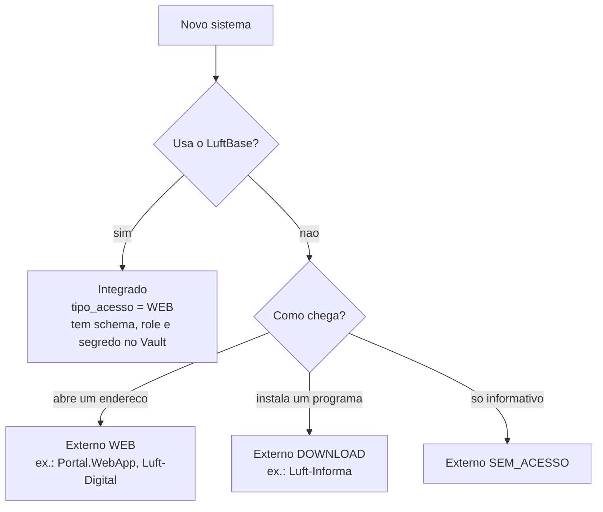

# Sistemas e catalogo

O **catalogo** e a lista de tudo o que existe no ecossistema Luft: cada sistema tem **uma linha** em `core.tb_sistema`. E ele que
alimenta o hub do Luft-Workspace (os cards), o Painel de Controle, as permissoes de acesso e a descoberta dos servicos no servidor.

Nem tudo no catalogo e uma aplicacao Flask do LuftBase. Por isso um sistema e descrito por **tres perguntas independentes**:

| Pergunta | Campo | Valores |
|---|---|---|
| **O que e?** (agrupamento e selo) | `categoria` | veja [categorias](#categorias) |
| **Usa o LuftBase?** (login, permissoes, banco) | `integra_luftbase` | `true` / `false` |
| **Como a pessoa chega ate ele?** | `tipo_acesso` | `WEB`, `DOWNLOAD`, `SEM_ACESSO` |



## Os tres tipos na pratica

| Tipo | Exemplo | Schema, role e Vault? | Login e permissoes | O card faz |
|---|---|---|---|---|
| **Integrado** | Luft-ConnectAir, Luft-Integrador | **sim** | do LuftBase | abre o sistema |
| **Externo web** | Portal.WebApp (C#), Luft-Digital (do TI do grupo) | **nao** | da propria ferramenta | abre o `link` |
| **Externo download** | Luft-Informa (executavel) | **nao** | da propria ferramenta | leva ao `url_download` (ex.: pagina do atualizador) |
| **Externo informativo** | ferramenta de terceiros sem acesso direto | **nao** | - | so aparece no catalogo |

Mesmo o sistema externo tem **permissao base de acesso**: o card so aparece para quem tem essa permissao, entao a equipe de
seguranca continua decidindo quem o enxerga. O LuftBase, porem, **nao controla** o login nem o banco da ferramenta externa.

> **Estado atual do hub:** o Luft-Workspace ainda abre o campo `link` de qualquer card. Usar `tipo_acesso` e `url_download`
> (por exemplo, levar o card de download direto ao atualizador) e a proxima mudanca do Workspace; os dados ja estao no catalogo.

## Categorias

A categoria so **agrupa e rotula** (selo, icone e cor do card). O comportamento vem de `integra_luftbase` e `tipo_acesso`.
A lista fica em [`persistencia/core/categorias_sistema.py`](../src/luftbase/persistencia/core/categorias_sistema.py) e e usada
pelo banco, pela validacao, pela CLI e pela tela.

| Codigo | Rotulo | Para que serve |
|---|---|---|
| `APLICACAO` | Aplicacao web | sistema com telas, usado no navegador (padrao) |
| `API` | API | servico de dados sem interface, consumido por outros sistemas |
| `SERVICO` | Servico / Daemon | rotina que roda em segundo plano, sem tela |
| `FERRAMENTA` | Ferramenta / Executavel | programa instalado no computador, entregue por download |
| `RELATORIO` | Relatorios e paineis | dashboards e relatorios de consulta (BI) |
| `INTEGRACAO` | Integracao / Conector | troca de dados entre sistemas, ERPs e parceiros |
| `HUB` | Hub / Portal central | ponto de entrada que reune os demais (so o Workspace) |

Uma aplicacao satelite nao se declara `HUB` no seu catalogo; o `HUB` e o portal central.

## Regras que o banco garante

Sao `CHECK` na tabela e **tambem** validacoes na tela e na CLI (o mesmo validador), para a mensagem aparecer no campo certo:

- `categoria` precisa ser uma da lista acima;
- `tipo_acesso = DOWNLOAD` **exige** `url_download`; em outros tipos a URL nao e guardada (nao sobra endereco de uma escolha antiga);
- sistema que **integra o LuftBase e sempre `WEB`**: para usar `DOWNLOAD` ou `SEM_ACESSO`, desmarque a integracao;
- sistema externo **nao tem** schema, role nem segredo.

## Como cadastrar

### Pelo Painel de Controle (o caminho do dia a dia)

**Painel de Controle > Aplicacoes & Ambiente > Sistemas > Novo sistema** (exige a permissao de criar sistemas e ser o sistema
master). A categoria e escolhida em **cartoes** (icone, nome e uma frase sobre cada opcao; as setas do teclado tambem trocam a
escolha); **Ferramenta** ja sugere "nao integra o LuftBase" com acesso por download.

Para um **sistema integrado**, a opcao **Provisionar banco e Vault agora** faz tudo numa operacao: cria o schema, a role
`luft_<schema>_<sufixo>_app` com senha aleatoria e o segredo `sistemas/<id>`. O token do Vault e o usuario/senha
administrativos sao usados so naquela operacao e **nunca gravados**.

### Pela linha de comando

```powershell
# Sistema integrado, junto com a pasta do projeto (ambiente de desenvolvimento)
python -m luftbase projeto novo Luft-Faturas --destino <pasta>

# Sistema externo (sem schema nem Vault)
python -m luftbase sistema externo Luft-Informa --tipo-acesso download --url-download /Luft-Workspace/atualizador
python -m luftbase sistema externo Portal.WebApp --tipo-acesso web --link https://portal.exemplo.com.br
```

Detalhes e opcoes: [referencia da CLI](23-REFERENCIA-DA-CLI.md). A CLI so opera em desenvolvimento e homologacao; producao se
cadastra pelo Painel.

## O que um cadastro cria

Para **todo** sistema, numa unica transacao:

1. a linha em `core.tb_sistema`;
2. o modulo **`PLATAFORMA`** do sistema;
3. a **permissao base de acesso** `<PREFIXO>.SISTEMA.ACESSAR` (`eh_acesso_sistema = true`), onde o prefixo e o nome em
   maiusculas com tudo que nao for letra ou numero trocado por `_` (`Luft-Faturas` vira `LUFT_FATURAS`);
4. a concessao dessa permissao ao grupo do criador (ou ao grupo 6, TI).

So para **sistema integrado com provisionamento**:

5. o **schema** do sistema no PostgreSQL;
6. a **role** `luft_<schema>_app` em producao, ou `luft_<schema>_hml_app` / `luft_<schema>_dev_app` fora dela (o sufixo evita que
   cadastrar em homologacao troque a senha da role de producao, que e a mesma no cluster);
7. o **segredo** `luft/<ambiente>/bancos/postgresql/sistemas/<id>` no Vault, com `sistema_id`, `identificador`, `conexao`
   (qual conexao compartilhada), `esquema`, `usuario` e `senha`. Se o core nao confirmar o cadastro, o segredo e removido.

## Campos de `core.tb_sistema`

| Campo | O que e |
|---|---|
| `id_sistema` | chave. **Cada ambiente gera o seu**: o mesmo sistema pode ter IDs diferentes em desenvolvimento, homologacao e producao. O `0` e o Luft-Workspace |
| `nome_sistema` | nome unico. E tambem a chave para achar o servico no servidor (`Luft-ConnectAir` -> `luft-connectair.service` no Linux) |
| `descricao_sistema` | texto do card |
| `categoria` | veja acima |
| `integra_luftbase`, `tipo_acesso`, `url_download` | como o sistema se relaciona com a plataforma |
| `ativo` | sistema descontinuado deixa de aparecer e as rotas respondem "descontinuado" |
| `em_manutencao` | o middleware responde 503 nas rotas comuns; `/_luftbase/saude`, login e estaticos continuam |
| `ordem_exibicao` | ordem nos paineis (0 a 32767) |
| `icone`, `cor` | icone Phosphor (`ph-bold ph-...`) e cor `#RRGGBB` do card |
| `link` | rota (`/Luft-Integrador/`) ou URL completa |
| `url_saude` | endereco do healthcheck |
| `responsavel`, `contato_suporte` | quem cuida e como pedir ajuda |
| `schema_aplicacao` | schema do sistema no PostgreSQL (so integrados) |
| `metadados_json` | reservado |

O **icone** e escolhido num catalogo visual (botao "Escolher..."): 225 icones em 11 segmentos, com busca por nome ou palavra-chave
(ignora acento e maiuscula; varias palavras exigem todas), duplo clique para aplicar e a cor do sistema no destaque.

## Alterar e descontinuar

- Editar um sistema: **Painel de Controle > Sistemas**, botao de editar no card. O sistema `0` (Workspace) so permite consulta.
- **Descontinuar** (`ativo = false`) tira o sistema do ar para todos e exige uma permissao propria
  (`CONFIGURACOES.SISTEMAS.DESATIVAR`). Sem ela, o checkbox "Ativo no Catalogo" fica desabilitado e a API responde 403 com
  mensagem, sem salvar nada. O card passa a mostrar "DESATIVADO - OCULTO NO HUB" e o Hub deixa de listar o sistema.
- Toda criacao e alteracao entra na **auditoria** com o antes e o depois.
