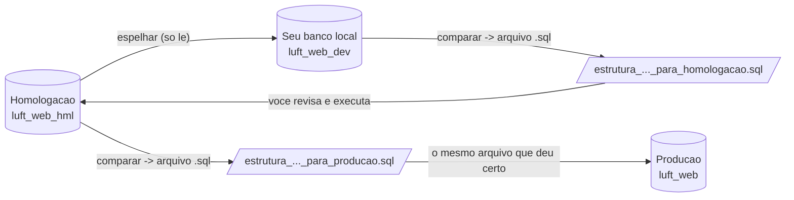
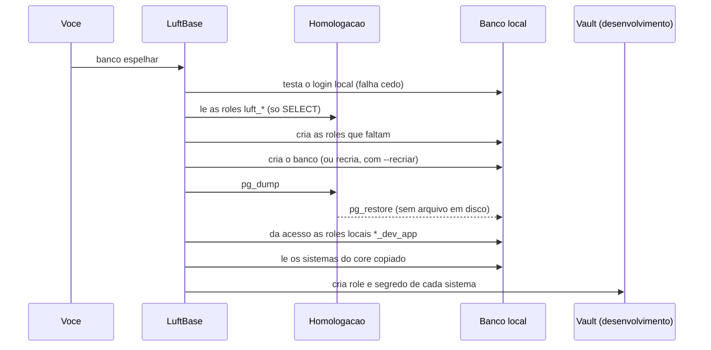

# Banco local e promocao de estrutura

Este documento responde a duas perguntas de quem desenvolve:

1. **Como ter um banco meu, na minha maquina, para mexer sem medo?** (espelho, core local em dia)
2. **Como levar para homologacao e producao as tabelas que eu criei?** (comparar estruturas e gerar SQL)

Tudo aqui e a explicacao detalhada dos comandos `banco espelhar`, `banco atualizar-core` e `banco comparar`
([referencia da CLI](23-REFERENCIA-DA-CLI.md)). A decisao esta registrada no
[ADR-018](decisoes/ADR-018-TIPOS-DE-SISTEMA-ESPELHO-LOCAL-E-PROJETO-NOVO.md).

## A ideia em um desenho



- O **sentido dos dados** e de homologacao para a sua maquina (e so copia, nunca escreve na origem).
- O **sentido da estrutura** e o contrario: do que voce desenvolveu para homologacao e, depois, para producao.
- Em nenhum dos dois o LuftBase aplica nada sozinho nos ambientes compartilhados: **o `.sql` e sempre revisado e executado por uma pessoa**.

---

## Parte 1: o seu banco local

### Quando usar cada opcao

| Quero... | Faca |
|---|---|
| um banco **igual ao de homologacao**, com dados, para testar com cenarios reais | `banco espelhar` |
| um banco **limpo**, so com tabelas, para desenvolver do zero | `banco espelhar --somente-estrutura` |
| continuar com o meu banco atual, so colocar o `core` em dia | `banco atualizar-core` |

### O que voce precisa

- um **PostgreSQL local** (Docker ou WSL servem) e o usuario administrativo dele;
- `pg_dump` e `pg_restore`, de versao **igual ou mais nova** que a do servidor de homologacao. No Windows com banco no WSL,
  instale no Linux: `sudo apt install postgresql-client`, e use `--via-wsl`;
- o token do Vault e o usuario/senha administrativos **de homologacao** (a origem so e lida).

### Espelhar homologacao

```powershell
python -m luftbase banco espelhar --via-wsl --usuario-destino admin
```

Os pedidos aparecem na ordem abaixo; **cada senha e de um banco diferente**:

| Pedido | De que banco e |
|---|---|
| Token de operador do Vault | do Vault (um so para todos os ambientes) |
| Usuario e senha administrativos **do servidor mostrado** | do banco de **homologacao** (origem) |
| Senha de `<usuario-destino>` no PostgreSQL **LOCAL** | do **seu** banco (destino) |

O que o comando faz, em ordem:



**O que e copiado e o que nao e**

| Item | Comportamento |
|---|---|
| Tabelas, dados, indices, constraints | copiados (integral; com `--somente-estrutura`, so a estrutura) |
| Roles `luft_*` de aplicacao | **criadas** com o mesmo hash de senha da origem |
| Role que **ja existe** localmente | **mantem a senha local** (use `--sobrescrever-senhas` para trocar pela da origem) |
| Roles de superusuario | **nunca** copiadas (aplicar a `postgres` de homologacao trocaria a senha do administrador local) |
| Permissoes (GRANT) para roles que nao existem localmente | ignoradas, e o comando diz quais |
| Usuarios, sessoes e logs de homologacao | **vem junto** na copia integral: trate o banco local como dado de homologacao |

**Regras de seguranca que nao dependem de flag**

- o destino e **sempre a propria maquina** (`localhost`, `127.0.0.1` ou `::1`);
- a origem **nunca e producao**;
- senhas vao por variavel de ambiente do processo, nunca na linha de comando;
- `--recriar` **apaga** o banco local: o comando pede para voce digitar o nome dele.

### Depois do espelho: o Vault de desenvolvimento

O core copiado traz os sistemas **de homologacao** (IDs 0, 1, 2...). Para uma aplicacao subir em desenvolvimento, cada um precisa
de um segredo em `luft/desenvolvimento/bancos/postgresql/sistemas/<id>`. O proprio `banco espelhar` cria, para cada sistema com
schema:

- a role `luft_<schema>_dev_app` com senha aleatoria (nunca exibida) e acesso ao core e ao schema;
- o segredo no Vault de **desenvolvimento** (e so nele; homologacao e producao nao sao tocadas).

Um segredo que ja existe e **bate** (mesmo schema e mesma role) e mantido. Um que aponta para **outro** schema ou role vira
**conflito** e nao e alterado sem `--substituir-segredos`. `--sem-vault` pula esta etapa.

> **Confira o `nome_banco` da conexao do Vault.** O segredo `luft/desenvolvimento/bancos/postgresql/conexoes/<alias>` diz **em que
> banco** as aplicacoes de desenvolvimento conectam. Se ele aponta para outro banco que nao o espelho, o comando avisa
> (`aviso=a conexao ... aponta para o banco ...`) e as aplicacoes continuam vendo o outro banco. Duas saidas: ajustar o
> `nome_banco` no Vault, ou usar as variaveis abaixo no `.env` do projeto.

### Apontar uma aplicacao para o espelho (`LUFT_BANCO_LOCAL_*`)

Por padrao a aplicacao conecta onde o Vault manda. Para redirecionar **so host, porta e nome do banco** (usuario, senha e schema
continuam os do Vault), ponha no `.env`:

```text
LUFT_BANCO_LOCAL_HOST=localhost
LUFT_BANCO_LOCAL_PORTA=5432
LUFT_BANCO_LOCAL_NOME=luft_web_dev
```

O comando imprime estas linhas ao terminar, ou as grava com `--configurar-env <.env>`. Regras: o host so pode ser a propria maquina
e a chave e **recusada em producao**. Para tirar o redirecionamento, apague as linhas.

> **Atencao ao ambiente.** O que decide **quais** roles e segredos a aplicacao usa e o `LUFT_AMBIENTE`. Em `desenvolvimento` ela usa
> as roles `*_dev_app` (que o espelho cria no passo do Vault). Se voce rodar a aplicacao com `LUFT_AMBIENTE=homologacao` contra o
> espelho, ela usara as roles `*_hml_app`, que existem no espelho porque vieram da copia.

### Core desatualizado

O banco copiado pode estar numa revisao do `core` **anterior** a deste LuftBase. O sintoma e uma mensagem como
"o core esta na revisao X e este LuftBase espera Y" (ou, sem a checagem, `column ... does not exist`). Corrija com:

```powershell
python -m luftbase banco atualizar-core
```

Ele mostra `revisao_atual` e `revisao_alvo`, pede confirmacao e aplica as migracoes pendentes e a sincronizacao do catalogo do
Workspace. Use um usuario administrativo **do banco local** (o dono das tabelas copiadas e quem restaurou o dump, por padrao o
`admin` do container). Funciona so em desenvolvimento; homologacao e producao evoluem pelo Workspace
([doc 20](20-OPERACAO-E-DEPLOY.md)).

---

## Parte 2: levar a estrutura para homologacao e producao

### O fluxo

1. Voce cria as tabelas do sistema no **seu** banco, no schema do sistema (modelos em `App/Models/POSTGRES/`).
2. O sistema e cadastrado em **homologacao** (Painel de Controle), o que cria la o schema e a role, **vazios**.
3. Voce gera o SQL que cria em homologacao o que so existe no seu banco:

   ```powershell
   python -m luftbase banco comparar --schema faturas --origem desenvolvimento --destino homologacao
   ```

4. Revisa e executa o arquivo em homologacao (DBeaver, psql...) com um usuario **dono do schema**.
5. Validada a aplicacao em homologacao, repete para producao com o resultado ja conferido:

   ```powershell
   python -m luftbase banco comparar --schema faturas --origem homologacao --destino producao
   ```

   (O comando so le o catalogo de producao e grava um arquivo; quem executa e voce.)

### O que o comando mostra

Para cada schema, uma lista de diferencas. O marcador diz o que fazer:

| Marcador | Significa | O que fazer |
|---|---|---|
| `+` | o script **resolve** | revisar o arquivo `.sql` |
| `!` | **revisao manual**: um script nao resolve com seguranca | decidir e tratar a mao |

Exemplo:

```text
faturas: 3 diferenca(s)
  + Tabela tb_fatura ausente.
  + Constraint tb_fatura.pk_tb_fatura ausente.
  ! Tabela tb_legado existe so em homologacao (nao e removida).
  sql=.\estrutura_faturas_desenvolvimento_para_homologacao.sql
legenda: + o script resolve, ! exige revisao manual
```

Tambem mostra `core: desenvolvimento=<revisao> homologacao=<revisao>` e avisa se forem diferentes (o core nao se compara por
script: ele evolui por migracoes).

### O que o `.sql` gerado faz (e o que nunca faz)

| Garantia | Como |
|---|---|
| **So cria** | `CREATE SCHEMA/TABLE/SEQUENCE/INDEX IF NOT EXISTS`, `ADD COLUMN IF NOT EXISTS` |
| **Pode rodar duas vezes** | constraints protegidas por verificacao no catalogo (`DO $$ ... IF NOT EXISTS ...`) |
| **Tudo ou nada** | uma unica transacao (`BEGIN` ... `COMMIT`) |
| **Nunca apaga nem muda** | sem `DROP`; nao altera tipo, nulidade nem valor padrao: isso vai para o relatorio como `!` |
| **Ordem certa** | sequencias, tabelas, constraints, indices, chaves estrangeiras por ultimo, e os `GRANT` no fim |
| **Acesso da aplicacao** | concede ao final a role do sistema no destino (`luft_<schema>_<sufixo>_app`), se ela existir; se nao existir, avisa |

Casos que viram revisao manual (`!`): coluna com **tipo, nulidade ou padrao diferente**; coluna nova `NOT NULL` **sem valor
padrao** (falha se a tabela do destino tiver linhas); constraint ou indice de mesmo nome com definicao diferente; tabela que so
existe no destino.

### Limites (para nao se surpreender)

- Compara **schemas de aplicacao**. O `core` nao entra (evolui por Alembic).
- Compara estrutura, **nunca dados**: nada de linhas de tabela e lida.
- Nao compara funcoes, gatilhos, visoes nem tipos enumerados proprios; se o sistema usa, leve-os a mao.
- Ambos os lados precisam de um usuario que **leia o catalogo** (qualquer usuario conectavel le `pg_catalog`); o destino, para
  **executar** o arquivo, precisa de um usuario dono do schema.

---

## Scripts SQL de promocao do core

Algumas mudancas do **core** precisam chegar a homologacao e producao **antes** do deploy do Workspace. Ficam em
[`tools/sql/`](../tools/sql/), sao repetiveis, transacionais e terminam com consultas de conferencia. Rode **nesta ordem**:

| Ordem | Arquivo | O que faz | Revisao do Alembic |
|---|---|---|---|
| 1 | `20261015_tb_sistema_tipo_de_integracao.sql` | cria `integra_luftbase`, `tipo_acesso` e `url_download` em `tb_sistema`, com as constraints | `20261015_0016` |
| 2 | `20261015_tb_sistema_categorias.sql` | alarga o `CHECK` de `categoria` (API, FERRAMENTA, RELATORIO, INTEGRACAO) | `20261015_0017` |

Cada script **atualiza a revisao do Alembic** so se o core estiver na revisao imediatamente anterior, para o `banco atualizar` do
Workspace nao tentar aplicar a mesma migracao de novo. As migracoes correspondentes tambem toleram o script ja aplicado
(`IF NOT EXISTS`), entao a ordem entre "script" e "deploy" nao quebra nada. Execute com um usuario **dono das tabelas do `core`**.

---

## Quadro de seguranca

| Comando | Le | Escreve | Onde |
|---|---|---|---|
| `banco espelhar` | homologacao (origem) | **banco local** e **Vault de desenvolvimento** | so a sua maquina e `luft/desenvolvimento` |
| `banco atualizar-core` | core local | core local (migracoes) | so desenvolvimento |
| `banco comparar` | catalogo dos dois bancos | **um arquivo `.sql`** na sua pasta | nenhum banco |

## Se algo der errado

Os erros mais comuns (senha recusada, `pg_dump` nao encontrado, Vault sem segredo, coluna inexistente) estao em
[solucao de problemas](26-SOLUCAO-DE-PROBLEMAS.md).
